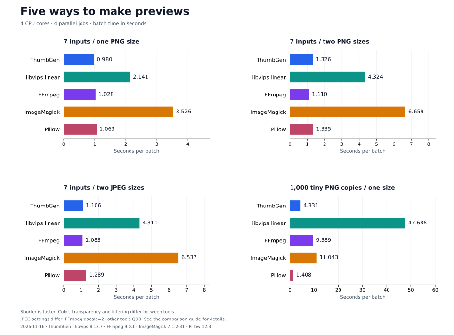

# ThumbGen

[简体中文](README.md) · [Documentation](docs/en/README.md) · [CLI reference](docs/en/cli.md)

**Native speed. OCIO color. Crypto, Deep and Z previews.**

ThumbGen makes thumbnails from everyday images and complex EXRs, fast. Decode once for multiple sizes, process large batches with parallel jobs, and run without Python.

`0.1.1` · [Apache-2.0](LICENSE)

## What can it do?

| Feature | What you get |
| --- | --- |
| **Fast** | One decode, multiple sizes, parallel batch processing |
| **Native C++** | A deployable C++17 command-line tool built on OpenImageIO |
| **[OCIO](docs/en/color-cms.md)** | Project color configurations, input spaces, displays and views |
| **[Crypto](docs/en/cryptomatte.md)** | Stable-color overviews of Cryptomatte IDs and coverage |
| **[Deep](docs/en/public-deep.md)** | Opt-in flattening of supported Deep EXRs into regular previews |
| **[Z depth](docs/en/data-preview.md)** | Fixed-range grayscale depth previews, consistent across a sequence |

Everyday PNG, JPEG, TIFF and other images work too, with alpha, orientation, multipart and channel selection. Integrating with scripts? Read file-by-file progress and results as JSONL.

## Speed and format support

Speed and format support for everyday images, EXRs and tiny-image batches. Values are **seconds per batch (lower is faster)** on Windows / i7-13700K with four CPU cores.



| Input / output | Parallel jobs × threads | ThumbGen | libvips linear | FFmpeg | ImageMagick | Pillow |
| --- | --- | ---: | --- | ---: | --- | --- |
| 7 everyday images / two PNGs | 4 × 1 | 1.326 | 4.324 | 1.110 | 6.659 | 1.335 |
| 7 everyday images / two JPEGs | 4 × 1 | 1.106 | 4.311 | 1.083 | 6.537 | 1.289 |
| 12 synthetic PNG16 images / one PNG | 4 × 1 | 1.564 | 3.238 | 2.604 | 3.623 | 1.141 |
| 1,000 tiny PNG copies / one PNG | 4 × 1 | 4.331 | 47.686 | 9.589 | 11.043 | 1.408 |
| 7 still EXRs / two PNGs | 1 × 4 | 1.435 | 6.789*† | 2.136 | 2.674* | Unsupported |
| 7 still EXRs / two PNGs | 4 × 1 | 2.437 | 5.056*† | 1.511 | 1.729* | Unsupported |
| 8 Beachball EXR frames / two PNGs | 4 × 1 | 0.710 | 3.002† | 0.235† | 1.094† | Unsupported |

<sub>* 6 of 7 images; the multiresolution EXR is unreadable. † Outputs have color or canvas issues.</sub>


ThumbGen supports layered EXRs and full sequence display canvases. Parallel jobs and thread counts can be adjusted to suit your images.

Single output fits 425×260; dual output adds 960×960. Color processing, filters and compression differ between tools, so consider image quality alongside speed. [Images and settings](docs/en/benchmarks.md).

[Performance data](docs/en/benchmarks.md) · [Public sample images](docs/en/public-assets.md)

## Platforms and formats

Available for Windows x64 and Linux x64, including CentOS 7.9 and Rocky Linux 9 environments.

Read OpenEXR, PNG, JPEG, TIFF, WebP, TGA, BMP, Radiance HDR and DPX; write JPEG, PNG and lossy WebP. Special formats and image layouts have [some restrictions](docs/en/color-cms.md). Run `thumbgen capabilities --json` to see the formats available in your copy.

## Quick start

Keep the complete program folder, including its shared libraries. Add it to PATH or use the executable's full path. [Installation →](docs/en/installation.md)

```sh
thumbgen convert frame.exr --output preview.jpg --size 960
thumbgen convert frame.exr --output-dir previews --size 425x260 --size 960x960
thumbgen convert frame.exr --output preview.png --background transparent
```

Images keep their aspect ratio and are not enlarged. Existing targets produce an error by default; use `--existing replace` to overwrite them.

For multilayer images or project colors:

```sh
thumbgen inspect multilayer.exr --json
thumbgen convert multilayer.exr --output beauty.jpg --channels Beauty
thumbgen convert frame.exr --output preview.jpg --ocio-config config.ocio --input-space ACEScg --display DISPLAY --view VIEW
```

Preview data channels and Deep images:

```sh
thumbgen convert depth.exr --output depth.png --visualize depth --channels Z --data-range 0,1000
thumbgen convert crypto.exr --output crypto.png --visualize cryptomatte --channels CryptoObject
thumbgen convert deep.exr --output deep.png --deep-mode flatten
```

Replace channel names and depth ranges with values from your files. Cryptomatte creates a colored overview, not named-matte extraction.

## Batch processing

Put files and output sizes in a job list, then run:

```sh
thumbgen batch --manifest jobs.json --json
```

Generate multiple sizes per image and process several images in parallel. JSONL results make it easy to track progress from scripts. [Batch example and result handling →](docs/en/protocol.md)

## Learn more

[Getting started](docs/en/getting-started.md) · [Command reference](docs/en/cli.md) · [Color management](docs/en/color-cms.md) · [All guides](docs/en/README.md)

For questions or bugs, include your version, platform, command and a small shareable input. Keep confidential assets and project color configurations private.

## License

ThumbGen is licensed under [Apache-2.0](LICENSE). Third-party dependencies retain their own licenses; see [dependencies](dependencies/).
