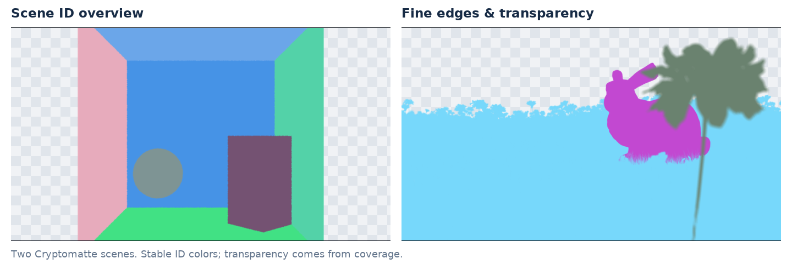
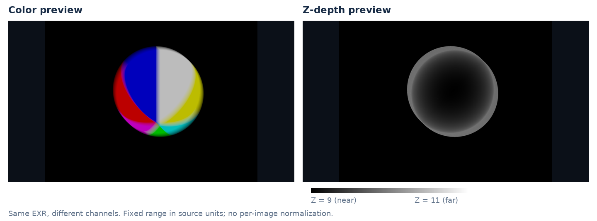
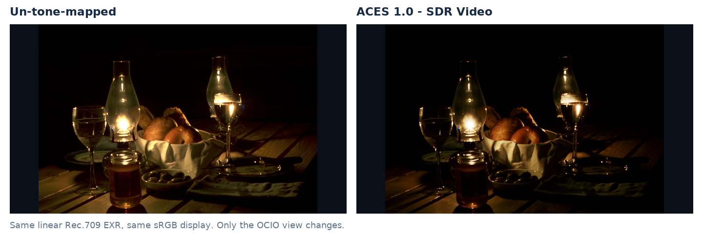

# ThumbGen

[简体中文](README.md) · [Documentation](docs/en/README.md) · [CLI reference](docs/en/cli.md)

**Native speed. OCIO color. Crypto, Deep and Z previews.**

ThumbGen makes thumbnails from standard images and complex EXRs, fast. Decode once for multiple sizes, process large batches with parallel jobs, and run without Python.

Fast, EXR-aware previews for production pipelines.

`0.1.6` · [Apache-2.0](LICENSE)

## Where it fits

For production workflows that need both batch throughput and access to EXR layers, channels and color information:

- **Render farms and result inspection**: generate multiple preview sizes in batches and browse color, normals, depth and Crypto to help inspect renders and AOVs.
- **Art, compositing and technical art pipelines**: use project OCIO settings to preview layered EXRs, data channels and supported Deep content.
- **Asset ingestion, version management and delivery**: create list and detail previews for EXRs, textures and HDR images, making assets, versions and deliverables easier to browse.
- **Desktop tools and cloud platforms**: integrate through the CLI and JSONL with file pickers, publishing panels or remote asset libraries. Generate previews where the files live to reduce large-file transfers while browsing.

## What can it do?

| Feature | What you get |
| --- | --- |
| **Fast** | One decode, multiple sizes, parallel batch processing |
| **Native C++** | A deployable C++17 command-line tool built on OpenImageIO |
| **[OCIO](docs/en/color-cms.md)** | Project color configurations, input spaces, displays and views |
| **[Crypto](docs/en/cryptomatte.md)** | Stable-color overviews of Cryptomatte IDs and coverage |
| **[Deep](docs/en/public-deep.md)** | Opt-in flattening of supported Deep EXRs into regular previews |
| **[Z depth](docs/en/data-preview.md)** | Fixed-range grayscale depth previews, consistent across a sequence |

Standard PNG, JPEG, TIFF and other images work too, with alpha, orientation, multipart and channel selection. Integrating with scripts? Read file-by-file progress and results as JSONL.

## Speed and format support

**Fast previews, with support for complex EXR.** Select channels, retain transparency and preserve the full display canvas. The comparison below shows processing times alongside format support and output limitations.


In the chart, each EXR and standard image produces two previews, small and large; each tiny image produces one. Previews preserve the original aspect ratio without stretching. Color, filtering and compression differ between tools. [Full results, output sizes and image sources →](docs/en/benchmarks.md)

## See the previews

### Cryptomatte: scene IDs and transparent edges



Turn IDs and coverage into a stable-color overview for checking objects and edges. This previews the whole family rather than extracting a named matte. [Using Cryptomatte →](docs/en/cryptomatte.md)

### Depth: make data channels visible



Select the Z channel and a range to create a grayscale preview. Keep the same range across frames for a consistent depth mapping. [Depth and data previews →](docs/en/data-preview.md)

### OpenColorIO: follow your project color settings



Use a project OCIO configuration and choose the input space, Display and View. Only the view changes above, showing different highlight and tone rendering. [Color management →](docs/en/color-cms.md)

These are actual ThumbGen outputs from publicly redistributable EXR samples. [Image sources and settings →](docs/en/public-assets.md#homepage-preview-images)

## Platforms and formats

Available for Windows x64 and Linux x64, including CentOS 7.9 and Rocky Linux 9 environments.

Read OpenEXR, PNG, JPEG, TIFF, WebP, TGA, BMP, Radiance HDR, DPX and supported PSD composites. Write JPEG, PNG and lossy WebP. See the [large-preview guide](docs/en/large-previews.md) for bounded layouts and budget settings. Run `thumbgen capabilities --json` to see the formats available in your copy.

## Quick start

Keep the complete program folder, including its shared libraries. Add it to PATH or use the executable's full path. [Installation →](docs/en/installation.md)

```sh
thumbgen convert frame.exr --output preview.jpg --size 960
thumbgen convert frame.exr --output-dir previews --size 425x260 --size 960x960
thumbgen convert frame.exr --output preview.png --background transparent
```

Images keep their aspect ratio and are not enlarged. Existing targets produce an error by default; use `--existing replace` to overwrite them.

For multilayer images or project colors:

```sh
thumbgen inspect multilayer.exr --json
thumbgen convert multilayer.exr --output beauty.jpg --channels Beauty
thumbgen convert frame.exr --output preview.jpg --ocio-config config.ocio --input-space ACEScg --display DISPLAY --view VIEW
```

Preview data channels and Deep images:

```sh
thumbgen convert depth.exr --output depth.png --visualize depth --channels Z --data-range 0,1000
thumbgen convert crypto.exr --output crypto.png --visualize cryptomatte --channels CryptoObject
thumbgen convert deep.exr --output deep.png --deep-mode flatten
```

Replace channel names and depth ranges with values from your files. Cryptomatte creates a colored overview, not named-matte extraction.

## Batch processing

Put files and output sizes in a job list, then run:

```sh
thumbgen batch --manifest jobs.json --json
```

Generate multiple sizes per image and process several images in parallel. JSONL results make it easy to track progress from scripts. [Batch example and result handling →](docs/en/protocol.md)

## Learn more

[Getting started](docs/en/getting-started.md) · [Command reference](docs/en/cli.md) · [Color management](docs/en/color-cms.md) · [All guides](docs/en/README.md)

For questions or bugs, include your version, platform, command and a small shareable input. Keep confidential assets and project color configurations private.

## License

ThumbGen is licensed under [Apache-2.0](LICENSE). Third-party dependencies retain their own licenses; see [dependencies](dependencies/).
