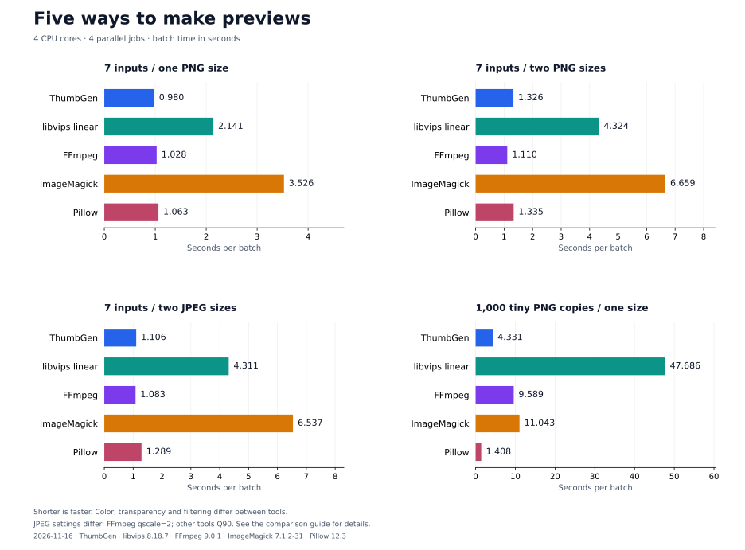
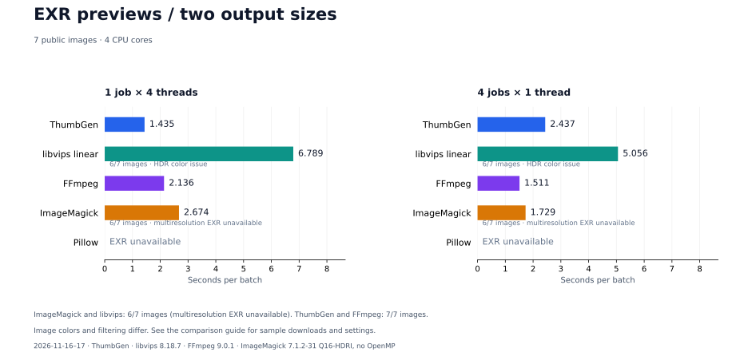
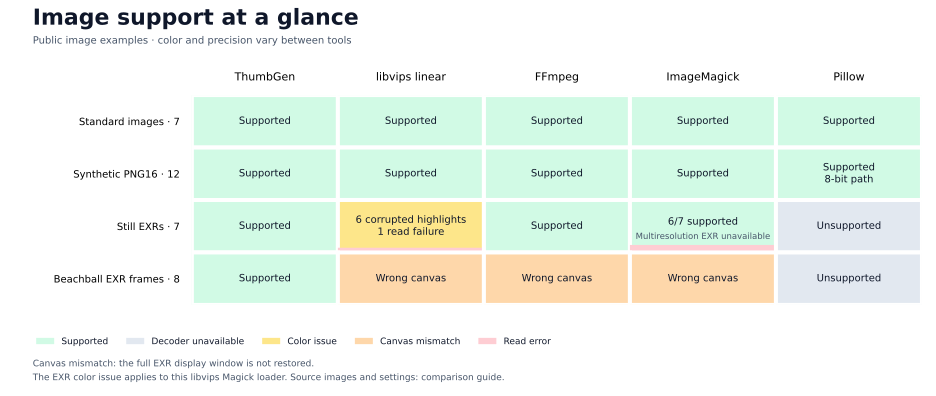

# ThumbGen

[English](README.en.md) · [文档目录](docs/README.md) · [CLI 参考](docs/cli.md)

**原生 C++ 的速度，OCIO 的颜色，Crypto / Deep / Z 的预览能力。**

ThumbGen 为普通图片和复杂 EXR 快速生成缩略图。一次解码输出多个尺寸，并行处理大批图片，运行时不需要 Python。

`0.1.1` · [Apache-2.0](LICENSE)

## 能做些什么

| 能力 | 可以做什么 |
| --- | --- |
| **快速** | 一次解码、多尺寸输出，支持并行批处理 |
| **原生 C++** | C++17 + OpenImageIO，可直接部署的命令行工具 |
| **[OCIO](docs/color-cms.md)** | 使用项目色彩配置，指定输入空间、display 和 view |
| **[Crypto](docs/cryptomatte.md)** | 将 Cryptomatte 的 ID 与 coverage 转成稳定配色的总览 |
| **[Deep](docs/public-deep.md)** | 显式展平受支持的 Deep EXR，生成普通预览图 |
| **[Z 深度](docs/data-preview.md)** | 按固定范围生成灰度深度预览，保持序列帧映射一致 |

PNG、JPEG、TIFF 等常见图片也能处理；支持 Alpha、方向、多 part 和多通道选层。需要接脚本时，直接读取逐文件的 JSONL 进度和结果。

## 速度与格式支持

普通图片、EXR 和小图批处理的速度与格式支持。下表为 Windows / i7-13700K、四核环境下的**整批处理耗时（秒，越低越快）**。



| 输入 / 输出 | 并行任务 × 线程 | ThumbGen | libvips linear | FFmpeg | ImageMagick | Pillow |
| --- | --- | ---: | --- | ---: | --- | --- |
| 普通图 7 份 / 双 PNG | 4 × 1 | 1.326 | 4.324 | 1.110 | 6.659 | 1.335 |
| 普通图 7 份 / 双 JPEG | 4 × 1 | 1.106 | 4.311 | 1.083 | 6.537 | 1.289 |
| 合成 PNG16 12 张 / 单 PNG | 4 × 1 | 1.564 | 3.238 | 2.604 | 3.623 | 1.141 |
| 小 PNG 1,000 份 / 单 PNG | 4 × 1 | 4.331 | 47.686 | 9.589 | 11.043 | 1.408 |
| EXR 静态图 7 份 / 双 PNG | 1 × 4 | 1.435 | 6.789*† | 2.136 | 2.674* | 不支持 |
| EXR 静态图 7 份 / 双 PNG | 4 × 1 | 2.437 | 5.056*† | 1.511 | 1.729* | 不支持 |
| EXR Beachball 8 帧 / 双 PNG | 4 × 1 | 0.710 | 3.002† | 0.235† | 1.094† | 不支持 |

<sub>* 6/7 份图片，多分辨率 EXR 无法读取。† 输出有颜色或画布尺寸问题。</sub>





ThumbGen 支持多层 EXR 和连续帧的完整显示画布，也可以按素材大小调整并行任务数与线程数。

单尺寸为 425×260，双尺寸再加 960×960。不同工具的色彩处理、滤波和压缩设置不同，速度需结合画质一起参考。[图片与参数](docs/benchmarks.md)。

[性能数据](docs/benchmarks.md) · [公开示例素材](docs/public-assets.md)

## 平台与格式

支持 Windows x64 和 Linux x64，已在 CentOS 7.9、Rocky Linux 9 等环境使用。

可读取 OpenEXR、PNG、JPEG、TIFF、WebP、TGA、BMP、Radiance HDR 和 DPX，输出 JPEG、PNG 和有损 WebP。特殊格式与图像布局有[部分限制](docs/color-cms.md)，可用 `thumbgen capabilities --json` 查看当前程序的格式支持。

## 快速开始

保留完整程序目录和随附动态库，加入 PATH，或直接用程序的完整路径运行。[安装说明 →](docs/installation.md)

```sh
thumbgen convert frame.exr --output preview.jpg --size 960
thumbgen convert frame.exr --output-dir previews --size 425x260 --size 960x960
thumbgen convert frame.exr --output preview.png --background transparent
```

图片保持比例，不放大小图。默认保留已有文件并提示错误，需要覆盖时加 `--existing replace`。

多层图片或项目色彩配置：

```sh
thumbgen inspect multilayer.exr --json
thumbgen convert multilayer.exr --output beauty.jpg --channels Beauty
thumbgen convert frame.exr --output preview.jpg --ocio-config config.ocio --input-space ACEScg --display DISPLAY --view VIEW
```

数据通道和 Deep 预览：

```sh
thumbgen convert depth.exr --output depth.png --visualize depth --channels Z --data-range 0,1000
thumbgen convert crypto.exr --output crypto.png --visualize cryptomatte --channels CryptoObject
thumbgen convert deep.exr --output deep.png --deep-mode flatten
```

通道名和深度范围请按实际文件调整。Cryptomatte 生成彩色总览，不按对象名称提取 matte。

## 批量处理

把文件和输出尺寸写进任务清单，然后运行：

```sh
thumbgen batch --manifest jobs.json --json
```

每张图可以生成多个尺寸，也可以并行处理多张图。JSONL 结果方便脚本跟踪进度。[清单示例与结果处理 →](docs/protocol.md)

## 继续了解

[快速上手](docs/getting-started.md) · [命令参考](docs/cli.md) · [色彩管理](docs/color-cms.md) · [全部指南](docs/README.md)

遇到问题，欢迎带上版本、平台、命令和可分享的小素材反馈；保密资产与项目色彩配置请留在本地。

## 许可证

ThumbGen 使用 [Apache-2.0](LICENSE) 许可证。第三方依赖保留各自的许可证，相关材料见 [dependencies](dependencies/)。
