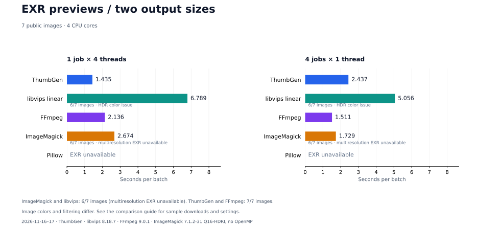
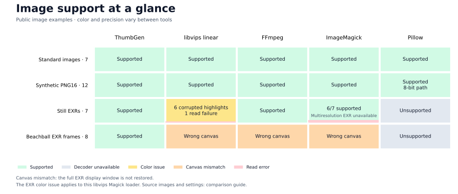

# Images and settings

[Documentation](README.md) · [简体中文](../benchmarks.md)

The homepage shows speed and format support for standard images, PNG16, EXR and tiny-image batches.

## Image sources

Standard images come from four public originals and three format derivatives. PNG16 uses twelve synthetic images; the tiny batch repeats one 256×192 PNG. EXR includes seven still images and an eight-frame Beachball sequence.

Download links, authors and licenses are in [image sources](../performance/public-assets.json).

## Output settings

One size fits within 425×260; two sizes add 960×960. Aspect ratio is preserved and small images are not enlarged. Previews are 8-bit.

Color processing, filters and compression differ between tools. Pillow resizes in 8-bit. FFmpeg JPEG uses q2 versus Q90 for the other tools; these are not equal-quality settings. The ImageMagick package has no OpenMP. The libvips EXR input uses a Magick loader with highlight color issues.

ImageMagick and libvips read six still images; the multiresolution EXR is unreadable. The libvips previews have highlight color issues. Beachball outputs from libvips, FFmpeg and ImageMagick use a different canvas.

## Speed, threads and support

Windows / i7-13700K, four CPU cores. Five-round medians in seconds; lower is faster.

| Input / output | Parallel jobs × threads | ThumbGen | libvips linear | FFmpeg | ImageMagick | Pillow |
| --- | --- | ---: | --- | ---: | --- | --- |
| 7 standard images / two PNGs | 4 × 1 | 1.326 | 4.324 | 1.110 | 6.659 | 1.335 |
| 7 standard images / two JPEGs | 4 × 1 | 1.106 | 4.311 | 1.083 | 6.537 | 1.289 |
| 12 synthetic PNG16 images / one PNG | 4 × 1 | 1.564 | 3.238 | 2.604 | 3.623 | 1.141 |
| 1,000 tiny PNG copies / one PNG | 4 × 1 | 4.331 | 47.686 | 9.589 | 11.043 | 1.408 |
| 7 still EXRs / two PNGs | 1 × 4 | 1.435 | 6.789*† | 2.136 | 2.674* | Unsupported |
| 7 still EXRs / two PNGs | 4 × 1 | 2.437 | 5.056*† | 1.511 | 1.729* | Unsupported |
| 8 Beachball EXR frames / two PNGs | 4 × 1 | 0.710 | 3.002† | 0.235† | 1.094† | Unsupported |

* 6 of 7 images; the multiresolution EXR is unreadable. † Outputs have color or canvas issues.

## Downloads

- [Processing time and memory](../performance/timings.csv)
- [Image support and limitations](../performance/coverage.json)
- [Environment and parameters](../performance/settings.json)
- [Public images](public-assets.md)
